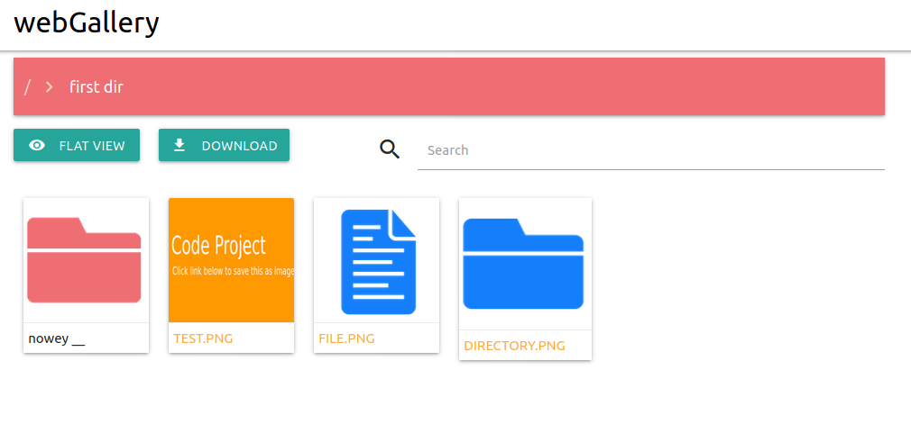

### What is it?
It's a simple web app made to show content on my OMV server.

### How to run it?
Easiest way to run is using docker container. 

`docker pull marekw96/webgallery`

`docker run -v path_to_dir_on_host:/webGallery/content -p 80:5000 -d webGallery`

Then it will be available on port 80 and shows _path_to_dir_on_host_

Thumbnails are generated on demand and cached under `thumbnails/`. To keep that cache across container restarts, mount a second volume:

`docker run -v path_to_dir_on_host:/webGallery/content -v path_to_thumb_cache:/webGallery/thumbnails -p 80:5000 -d webGallery`

Videos (mp4, webm, ogv/ogg) and photos are displayed in a unified media viewer with previous/next navigation, direct download, and automated slideshow. Video thumbnails require **ffmpeg** on `PATH` (included in the Docker image). For a local non-Docker run, install ffmpeg first.

### How it looks like?

### Used components
* flask
* docker
* Tailwind CSS
* materializecss
* Vue.js 
* Vue-lazy

### Few words at the end
Feel free to use it. Due to lack of permission and possibly some security flaws should be used only in intranet.